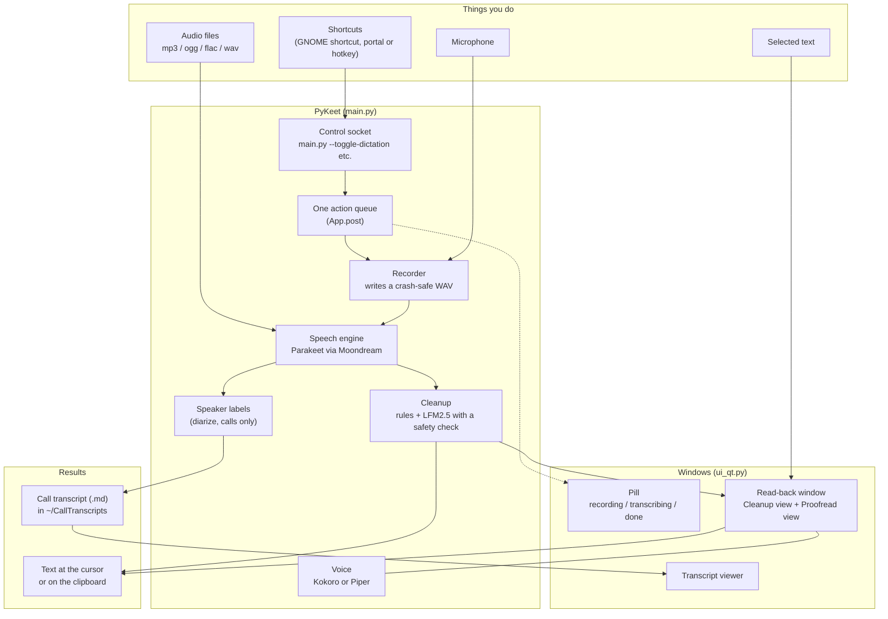
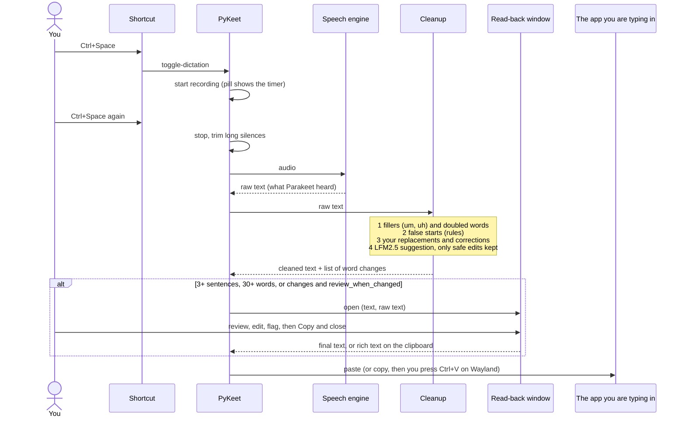
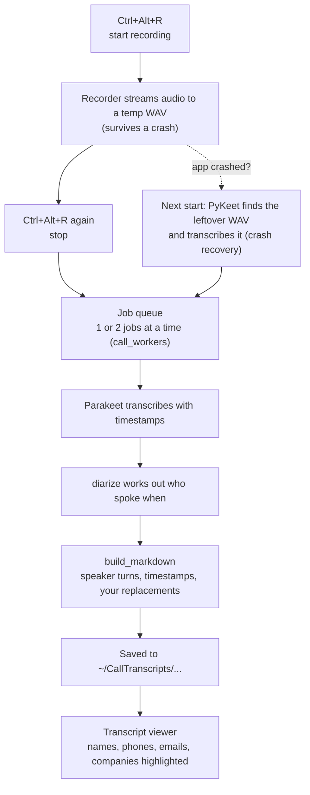
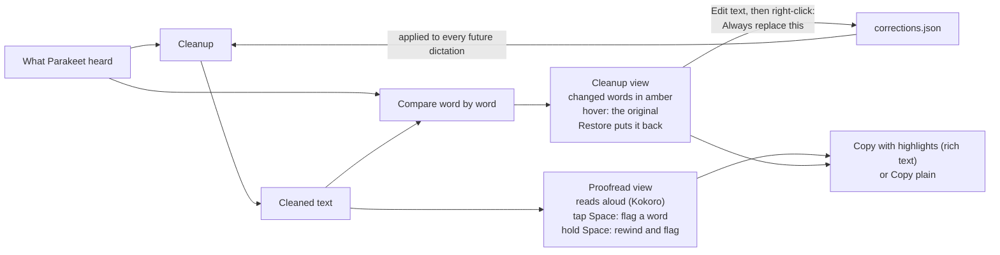
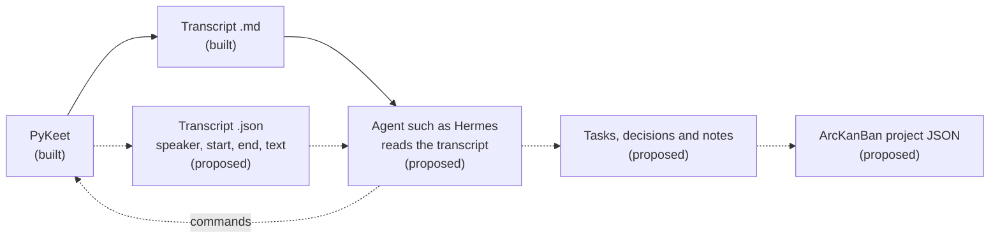

# How PyKeet fits together

PyKeet is one Python program (`main.py`) plus a few helper modules. This page shows the parts,
how a dictation and a call travel through them, and where something else (for example an agent
or a project board) could attach. GitHub draws the diagrams below; if you read this somewhere
else, paste a block into <https://mermaid.live>.

**Built** = exists today. **Proposed** = an idea, not built.

| File | Job |
|---|---|
| `main.py` | The app: shortcuts, recording, speech engine, cleanup, call jobs, files |
| `ui_qt.py` | Every window (Qt 6): the floating pill, transcript viewer, read-back window |
| `tts.py` | Text-to-speech for the read-back (Kokoro, Piper fallback) |
| `llm_cleanup.py` | The small language model (LFM2.5-350M) that helps clean a dictation |
| `portal.py` | Optional Wayland helpers (typing and shortcuts through desktop portals) |
| `config.toml` | Your settings |
| `corrections.json` | Fixes you taught PyKeet from the read-back window |

## 1. The big picture

## 2. A dictation, step by step

## 3. A call

Imported audio files follow the same path from the transcription step onwards.

## 4. The read-back window and how PyKeet learns

## 5. Where other tools could attach (proposed, not built)

PyKeet already has two seams that need no changes:

- **Commands in:** `python main.py --toggle-dictation`, `--toggle-call`, `--import`, `--recall`,
  `--pause`, `--quit`, `--show-last` talk to the running copy through a local socket. Anything
  that can run a command (a script, an agent) can start and stop a recording.
- **Files out:** every call ends as a Markdown transcript in `~/CallTranscripts`.

The natural next step is a second file next to each transcript with the same content as
structured data. This is the part that does not exist yet.

Pulling tasks and decisions out of a call is deliberately **not** done inside PyKeet any more
(the old rule-based detector was removed). A language model that reads the whole transcript is a
better fit, and that is the agent's job in this picture.
